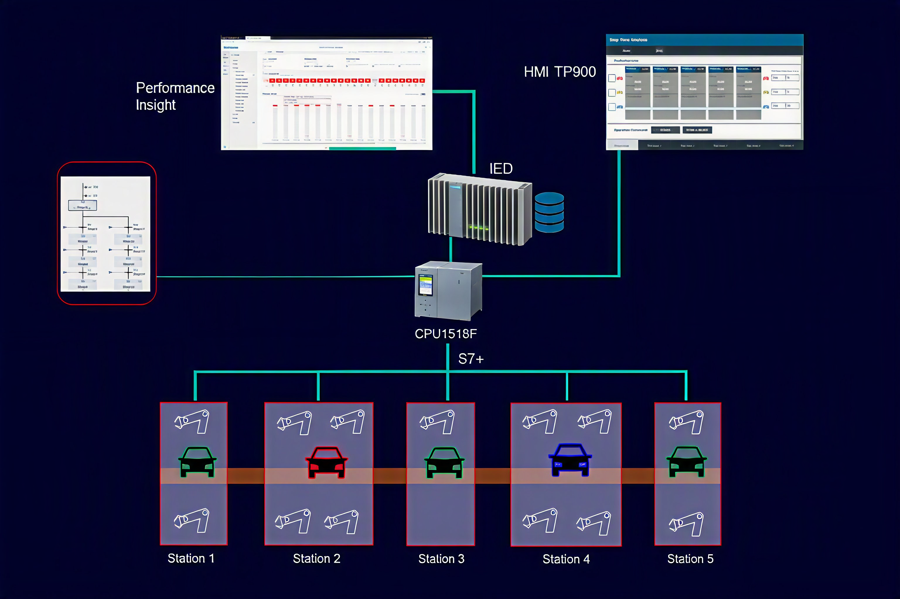
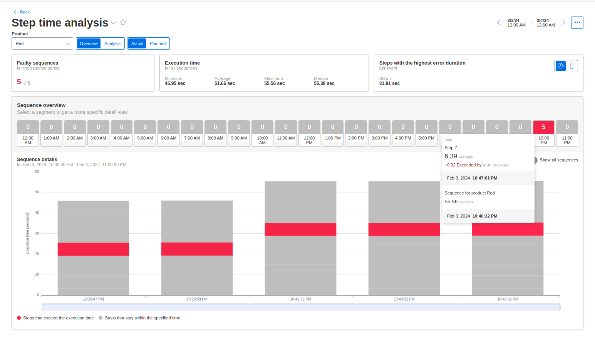

# Performance Analytics

Still must update: 
  - Image of TIA Portal Network
  - TIA file
  - Screen of Simulate Values

Below you can find the structure of this use case:

- [Performance Analytics](#performance-analytics)
  - [Description](#description)
    - [Overview](#overview)
    - [General Task](#general-task)
  - [Requirements](#requirements)
    - [Prerequisites](#prerequisites)
    - [Used components](#used-components)
  - [Configuration](#configuration)
  - [Usage](#usage)
  - [Documentation](#documentation)
  - [Contribution](#contribution)
  - [Licence and Legal Information](#licence-and-legal-information)

## Description

### Overview
The 'Step Time Analysis' dashboard of the Edge App 'Performance Insight' is used to assess the efficiency of the implemented sequential control systems. First, it needs to be synchronized with the asset model of the plant, representing the control systems in operation. This synchronization allows for the establishment of a reference duration for each step in the process. Then, the configured (or expected) step time is compared with the actual measured time during operation. 

This comparison makes it easier to identify specific steps in the production process that are experiencing delays, thereby enabling more targeted and efficient corrective actions.

This specific example shows how an exemplary production line is connected, the data from the plant is transferred to the edge system and evaluated there. This is shown using the step time analysis of a simulated automobile production with 5 assembly stations and randomly delayed steps.

### General Task

This sample application is based on one S7-1500 PLC controlling 5 stations that are port of the manufacturing process of cars. A sequential control system that was implemented with the TIA Portal programming language “Graph” runs on the PLC. 

The Industrial Edge Device connects to the PLC using the S7+ protocol.

And after setting other connections requirements on the Edge Device (explained in the [Configuration Steps](#configuration-steps)) we can use this data on the **Step Time Analysis** dashboard of the **Performance Insights** app.

For each implemented step the PLC shall provide a tag that carries the step activity status. For each sequential control an asset model with the activity status of the step needs to be configured and connected with the related PLC status tags. 

The option “Step time analysis” of the Edge App “Performance Insight” needs to be aligned with the asset model that represents the implemented sequential control systems in order to assign a reference duration for each step. This dashboard of the Edge App “Performance Insight” compares the configured and measured step time which allows localizing the steps that are causing delays.

## Requirements

### Prerequisites
* Industrial Edge Learning Path (Module 1-3)
*	Access to an Industrial Edge Management System (IEM)
*	Onboarded Industrial Edge Device (IED) on IEM
*	Establish connection to 5 PLCs for getting data into the IED
*	Installed system configurators (S7 Connector Configurator, Databus Configurator)
*	Installed apps on IED (S7 Connector, Databus, IIH Essentials, Performance Insight)
*	HTML5-capable Internet browser (e.g. Google Chrome)

### Used components
TIA and PLC:

*	TIA Portal V21
*	PLC: PLCSIM Advanced v8.0
*	HMI: WinCC Unified Runtime available

Industrial Edge:

*	Industrial Edge Management Virtual V1.15.20
*	Industrial Edge Virtual Device V1.28.1-2-b
*	SIMATIC S7+ Connector V2.5.0
* Common Import Converter V3.2.0
* Common Configurator V2.6.0
*	Databus V4.0.0
*	Databus Configurator V4.0.0
*	IIH Essentials V2.7.1
*	Performance Insight V1.26.0
*	Common Connector Configurator V2.0.0+5
*	Databus Configurator V3.2.2

## Configuration

You can find further information about the following steps under the [Configuration](docs/Installation.md) chapter:

-	Configure PLC project in TIA Portal
- Configure PLC connections in Industrial Edge
- Configure IIH Essentials
- Configure Performance Insight

## Usage

When you have created steps for the asset in IIH Essentials and you have defined the limits then the step time analysis is automatically displayed in the "Step time analysis" dashboard.

<kbd></kbd>

With the help of the "Overview" screen you can get all information about the sequences of a specific product for a specified time period. When the step is gray the step time is within the defined limits. A step displayed in red is outside the defined limits.

For Example, The image above shows the Step Time Analysis overview screen where five sequences have been completed. In every sequence, only the 7th step took longer than the expected completion time, marking it as faulty in red.

## Documentation

You can find further documentation and help in the following links

* [Industrial Edge Hub](https://iehub.eu1.edge.siemens.cloud/#/documentation)
* [Industrial Edge Forum](https://www.siemens.com/industrial-edge-forum)
* [Industrial Edge Documentation](https://docs.industrial-operations-x.siemens.cloud/p/industrial-edge)
* [Industrial Edge landing page](https://new.siemens.com/global/en/products/automation/topic-areas/industrial-edge/simatic-edge.html)
* [Industrial Edge GitHub page](https://github.com/industrial-edge)

## Contribution

Thank you for your interest in contributing. Anybody is free to report bugs, unclear documentation, and other problems regarding this repository in the Issues section.
Additionally everybody is free to propose any changes to this repository using Pull Requests.

If you haven't previously signed the [Siemens Contributor License Agreement](https://cla-assistant.io/industrial-edge/) (CLA), the system will automatically prompt you to do so when you submit your Pull Request. This can be conveniently done through the CLA Assistant's online platform. Once the CLA is signed, your Pull Request will automatically be cleared and made ready for merging if all other test stages succeed.

## Licence and Legal Information

Please read the [Legal information](LICENSE.md).
