# Configuration

- [Configuration](#configuration)
  - [Configure PLC project in TIA Portal](#configure-plc-project-in-tia-portal)
  - [Configure PLC Connections in Industrial Edge](#configure-plc-connections-in-industrial-edge)
    - [Configure Databus](#configure-databus)
    - [Configure PLC Connectors](#configure-plc-connectors)
  - [Configure IIH Essentials](#configure-iih-essentials)
    - [Enter Databus Credentials](#enter-databus-credentials)
    - [Link Connectors to IIH](#link-connectors-to-iih)
    - [Configure Assets](#configure-assets)
    - [Configure Aspects](#configure-aspects)
  - [Configure Performance Insight](#configure-performance-insight)
    - [Defining Limits](#defining-limits)

In order to set up the 'Step Time Analysis' dashboard within the Performance Insights application, it is essential to understand the flow of data across the system. The following diagram illustrates how data is communicated from the PLCs to the IED, and subsequently processed by the Edge applications:

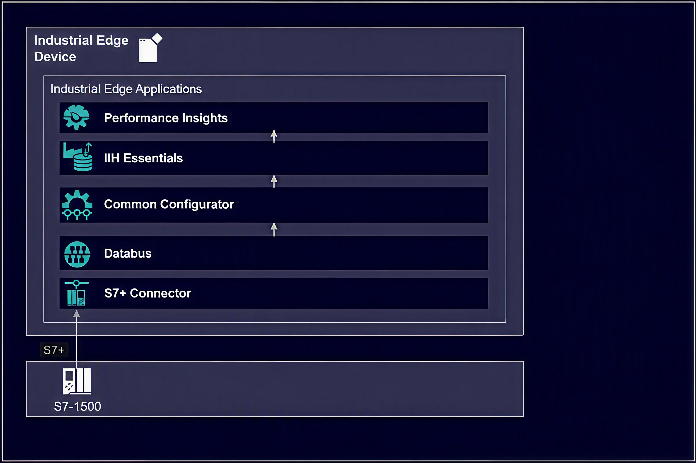

To achieve this data flow, the following configurations will be explained:

1. **S7+ Connector**: Set up the S7+ Connector to facilitate data transfer from the PLC using the S7+ protocol.

2. **Databus Configuration**: Integrate the MQTT-Broker to allow for a seamless data flow from the OPC UA and S7 Connectors to the higher-level Industrial Edge Applications.

3. **IIH Essentials**: Install and configure the IIH Essentials application to ensure that the core industrial data from your PLCs can be effectively harnessed and utilized by the IED. This setup is crucial for enabling comprehensive data collection and subsequent analysis within the Performance Insights application.

4. **Performance Insights**: Within the Performance Insights application, configure the 'Step Time Analysis' feature by linking it to the respective asset models, which reflect the status of the sequential control steps from the PLCs.

## Configure PLC project in TIA Portal

This use case contains a TIA project which simulates the process. The project also inclundes a HMI visualization to operate the demonstration process. Download the TIA Portal project [here](../src/StepTimeAnalysis_20221129_1438.7z). The first steps are to configure the PLC project and the intruduction into the HMI screens.

1.	Open TIA portal and open the project containing the car production application (Adapt the PLC type and IP addresses to your system for the PLC and HMI)

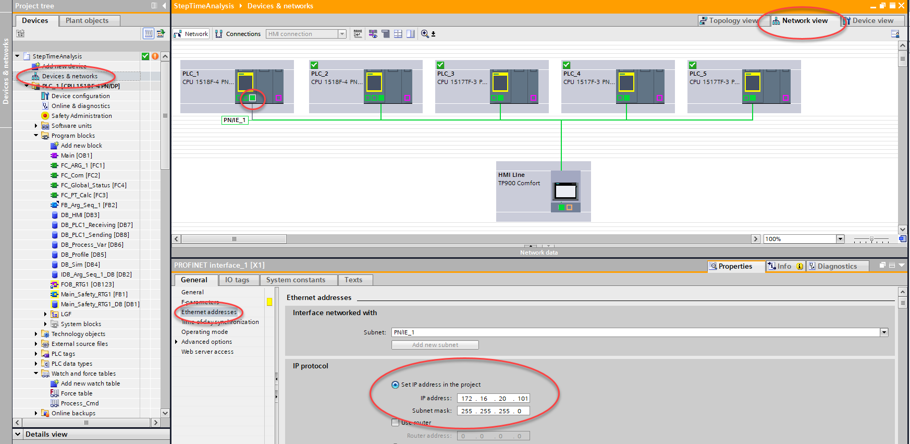

2.	Download the PLC program to the PLC and set it to RUN
3.	Open the HMI to control the car production application

### **Global Screen**:

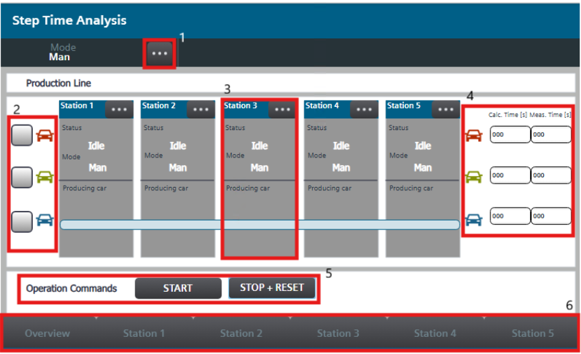

1. Select mode for all stations: Automatic or Manual
   
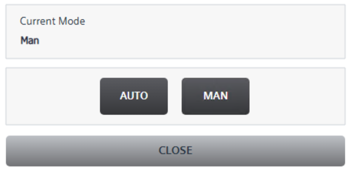

> Important information!: The mode can only be changed if the station is in Idle mode (not producing a car) 

2. Select the color car to produce 

3. Gives information about the station: 
  Status 
    Idle: empty station
    Busy: car being processed 
 
  Mode 
    Manual 
    Automatic 

  Producing car 
    Under it, it will show the car being produced 

  3 dots 
    Go into Station view details 

4. Gives production information about each car color 

5. Starts and Stops the entire production line. Reset only works if the stations are in manual mode 

6. Quick navigation bar to change view between stations and overview of general production 

### **Station Screen**:

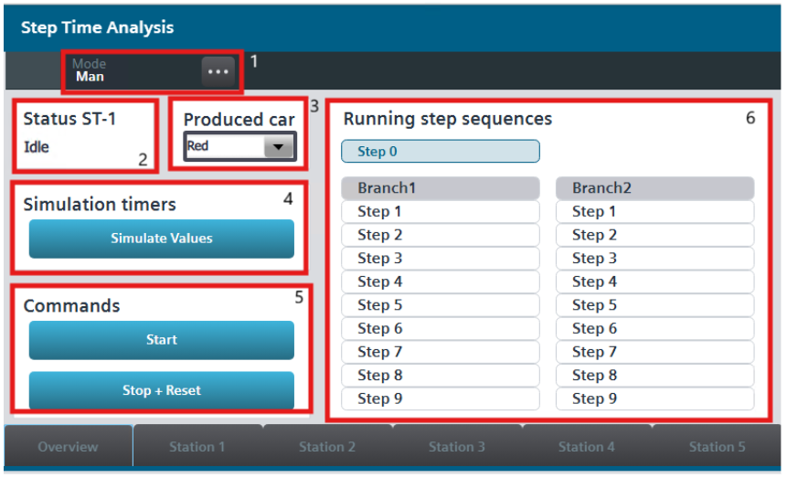

1. Select mode only for the station: Automatic or Manual 

2. Information on the status of the station: Idle/Busy 

3. Information on the color car being produced: 
    Dropdown list for manual mode
   
     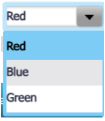

    Image of color car for automatic mode 
    
      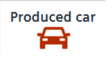

4. Switch to the delay select screen ("Simulate values")
   
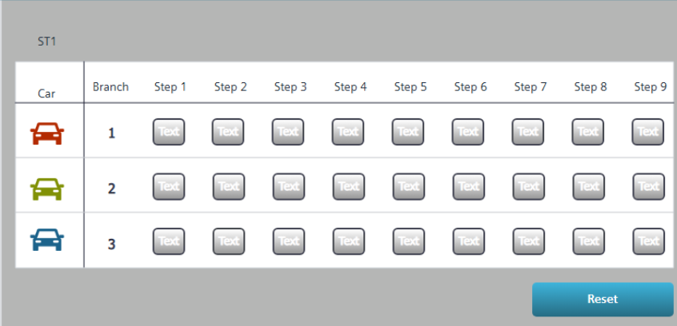

5. Commands to run at the specific station only when the station is on manual mode. 

Starts and Stops the production of the station 

6. Information about the current working step which is being made on the current station 

### **Delay Select Screen**:

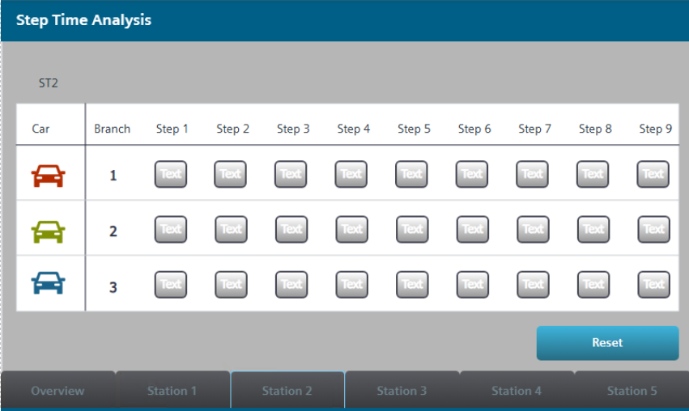

* Reachable via button “Simulate values” on each station
* Select which step time should be delayed
* When the step is selected, a random time between 0 and 10 seconds is added to the step

## Configure PLC Connections in Industrial Edge

We are now switching to the Edge part of this use case. Each of the following steps are done in the Industrial Edge system and, as explained in the Data Flow picture [above](#flow-data), we use the S7+ Connector on the IED to read data from the PLC and provide the data. Then, the data is sent via the connector to the Databus, where the IIH Essentials can use the information for enabling comprehensive data collection and subsequent analysis within the Performance Insights application.

In order to build this infrastructure, first, these apps must be configured correctly:

* Databus
* S7+ Connector

### Install Databus Configurator and Databus

If you haven't installed the databus on your IEM, go to Applications > Management, search for the Databus Configurator app and install it.

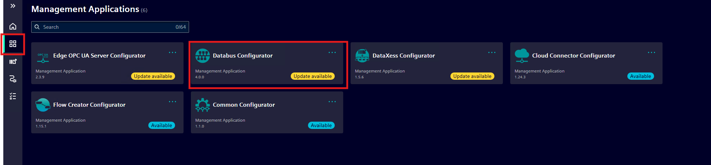

Then, on your IEM, go to Applications > Device, search for the Databus app and install it on the device that is going to be used

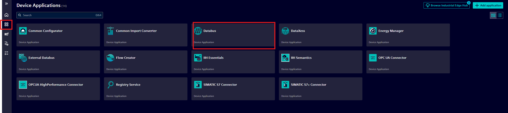

### Configure Databus

Go to the IEM UI > "Data Connections", select "Databus" and launch it on the onboarded IED.

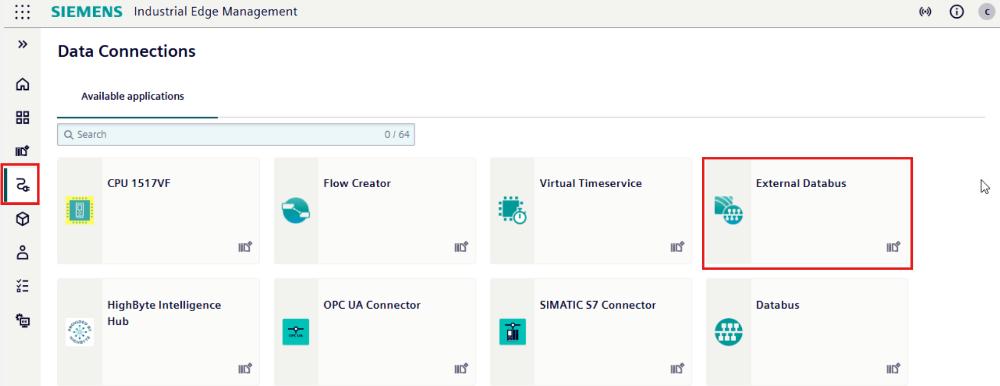

Select the device to launch and click on launch

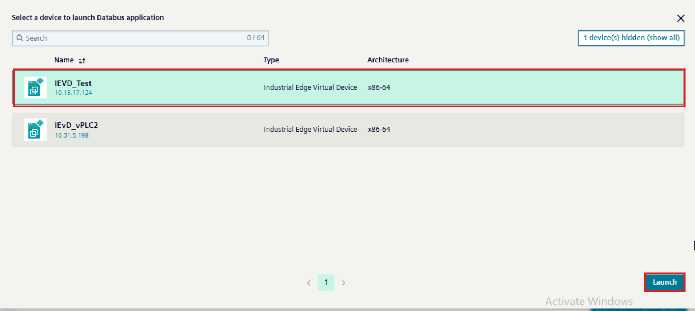

When the configurator is open, click on the "plus" icon in the red square to add an user: 

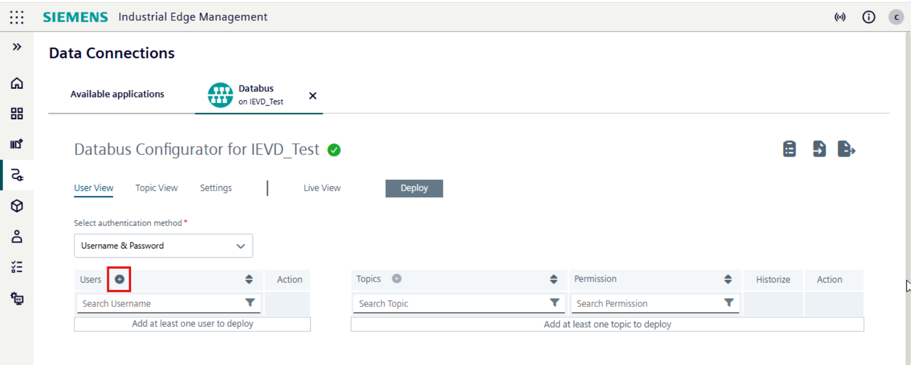

Add an user with the topic: `ie/#`. In this use case we use the credentials "edge" / "edge". The credentials can be chosen freely but must be the same in all system apps. Select "Publish and Subscribe" as permission. And lastly, click "Save".

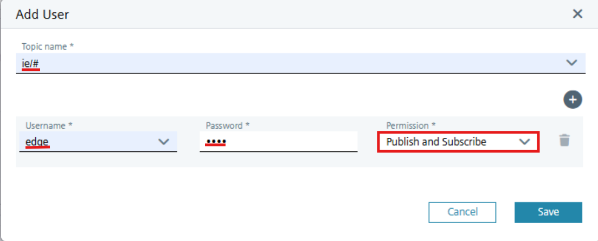

Then, just click *Deploy* to apply the changes:

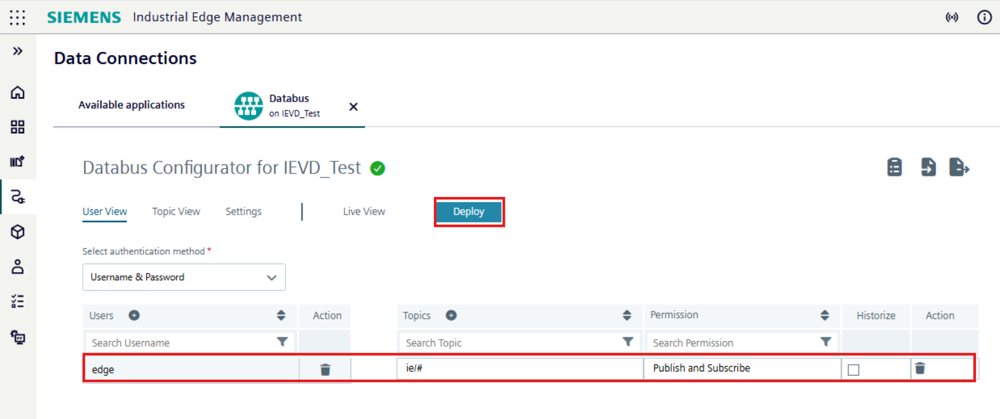

Selct the device to deploy the databus configuration.

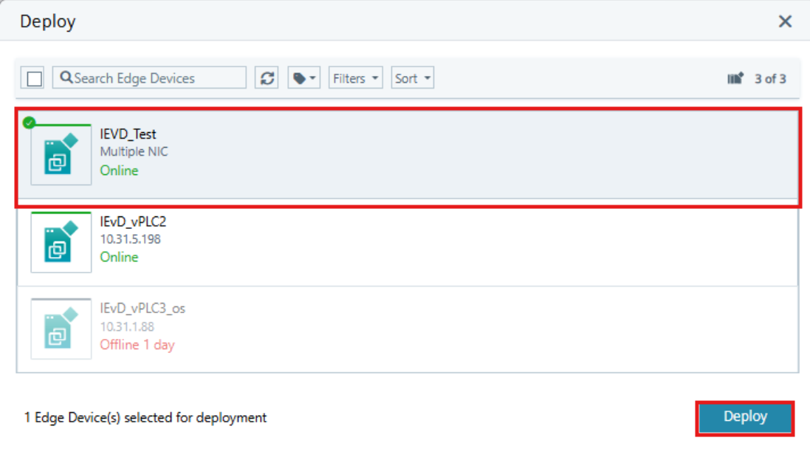

### Configure S7+ Connector

In this section, the communication with the PLC is configured using the S7+ Connector.

Open the Common Configurator

Before setting up the connector, edit the databus settings:

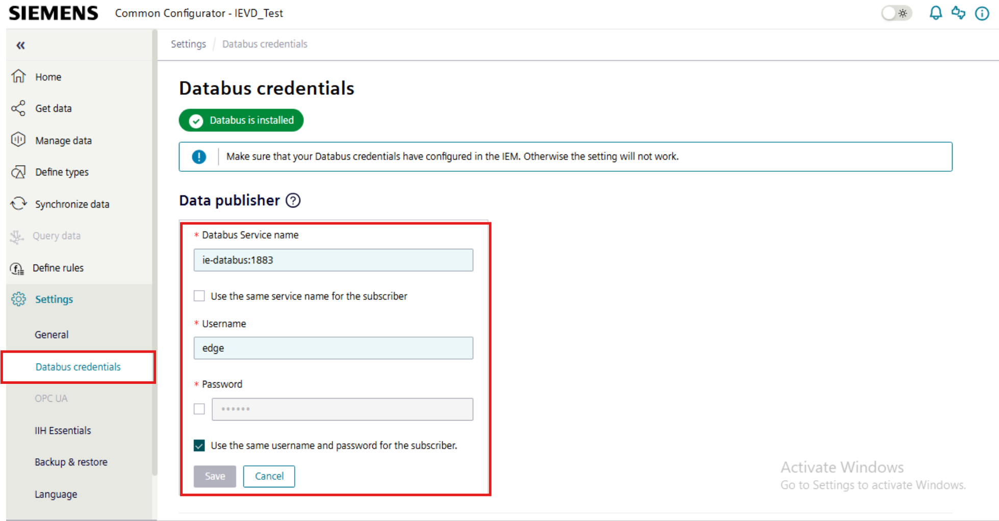

> Hint: Username and password should be the same as was set in the IE Databus configuration, e.g., "edge" / "edge".

Add a new data source for the PLC with the S7+ Connector by clicking on "Get Data":

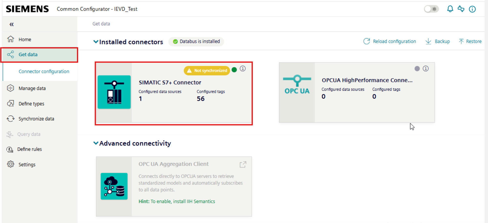

Click on the S7+ Connector and then under "Data source" click on "Add"

Enter your PLC details as shown in the image and click "Save":

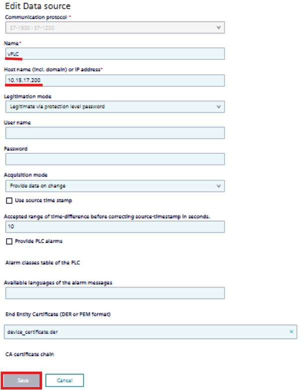

Use the "Browse tags" feature to add the necessary tags:

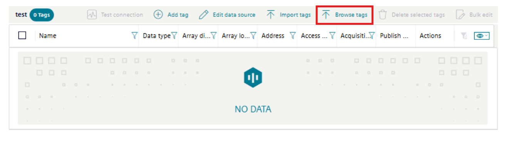

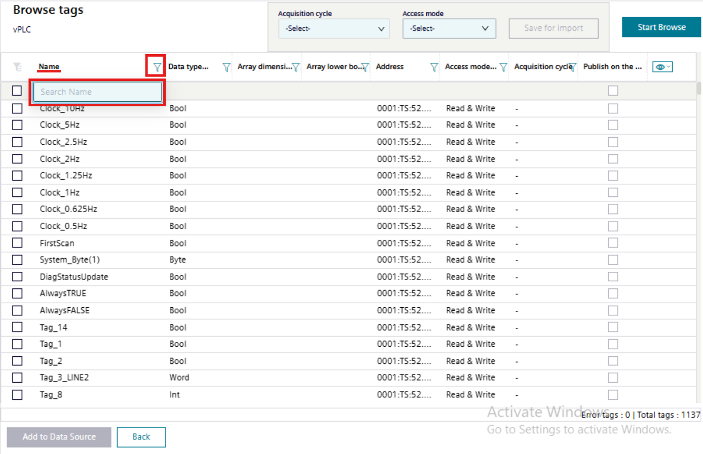

Tags to Browse:
- DB_HMI_PLC1.ARG1_Seq1_S2 up to DB_HMI_PLC1.ARG1_Seq1_S11
- DB_HMI_PLC2.ARG1_Seq1_S2 up to DB_HMI_PLC2.ARG1_Seq1_S11
- DB_HMI_PLC3.ARG1_Seq1_S2 up to DB_HMI_PLC3.ARG1_Seq1_S11
- DB_HMI_PLC4.ARG1_Seq1_S2 up to DB_HMI_PLC4.ARG1_Seq1_S11
- DB_HMI_PLC5.ARG1_Seq1_S2 up to DB_HMI_PLC5.ARG1_Seq1_S11
- DB_Process_Var_PLC1.Car_Type_inProduction_Text
- DB_Process_Var_PLC2.Car_Type_inProduction_Text
- DB_Process_Var_PLC3.Car_Type_inProduction_Text
- DB_Process_Var_PLC4.Car_Type_inProduction_Text
- DB_Process_Var_PLC5.Car_Type_inProduction_Text

Once all are selected, click on "Add to Data Source"

Select all tags and deploy the S7+ Connector by clicking "Deploy".

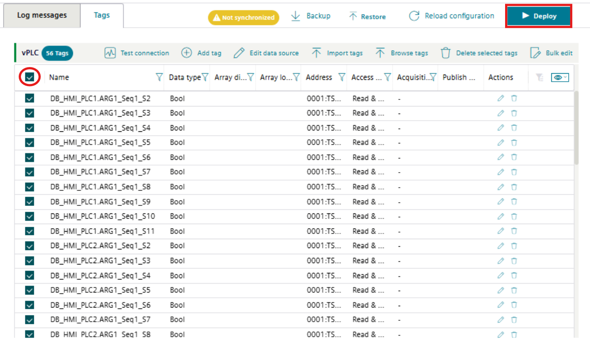

## Configure IIH Essentials

Steps are created for an asset as aspects in IIH Essentilas and automatically applied in Performance Insight. An asset represents, for this example, a car production "Station" and for each asset the aspects represents the steps.

<kbd>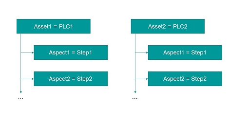</kbd>

Performance Insight use this structure of assets and aspects to visualize the data in a later step. Open the web interface of your IED and launch the IIH Essentials app. 

### Enter Databus Credentials

Firstly, Databus needs to be configured on IIH Essentials. To do that go to IED UI > Apps, open IIH Essentials and go to "Settings" > "Databus Settings", click on the edit icon:

<kbd>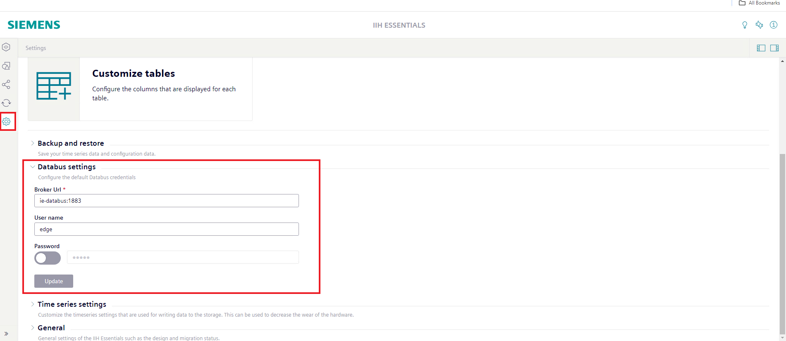</kbd>

Enter the needed data and click **save**.

### Link Connectors to IIH

Secondly, connectors need to be configured on IIH Essentials. To achive this, go to "Get Data" tab and click the "S7+ Connector" and it should be activated by default, shown by the green tick

If the connector is not in active state, select the connectors and click the edit icon on the top right to open the connector configuration tab and switch the "Status" to active:

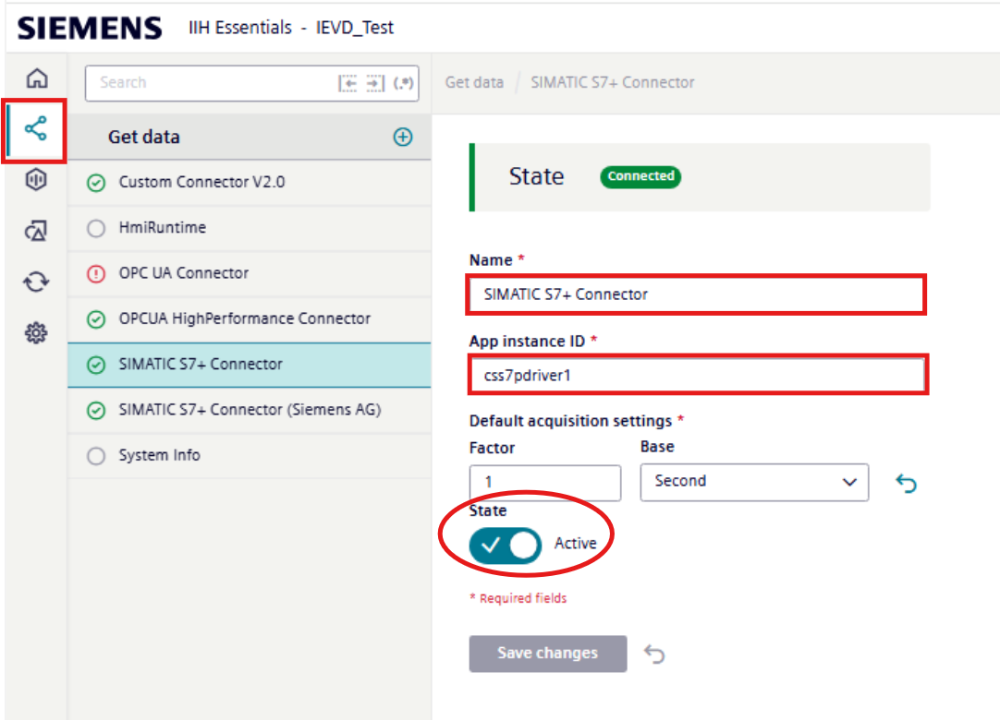

The status of the connector must be "Active" and the connector indicator shows "Connected":

### Configure Assets

Click on the icon "Manage Data" on the left bar. Add a child asset called "Manufacturing Process" for the main "edge" asset by clicking on the '+' icon: 

<kbd>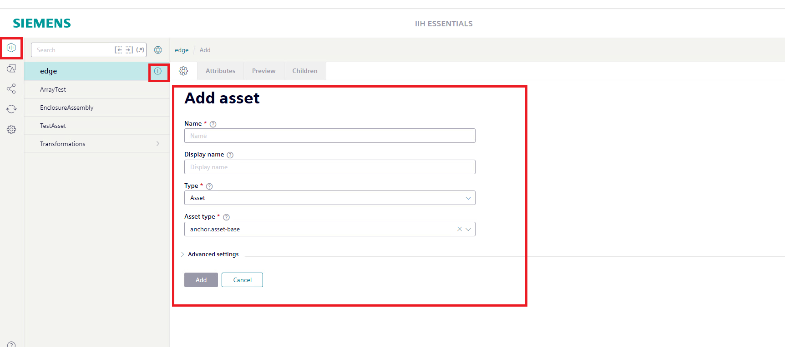</kbd>

Select the child asset "Manufacturing Process" and click this '+' icon to add 5 subassets from "station1" to "station5" 

<kbd>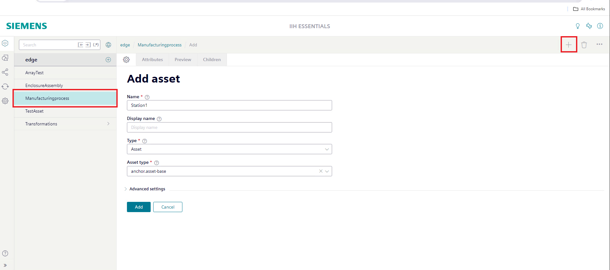</kbd>

<kbd>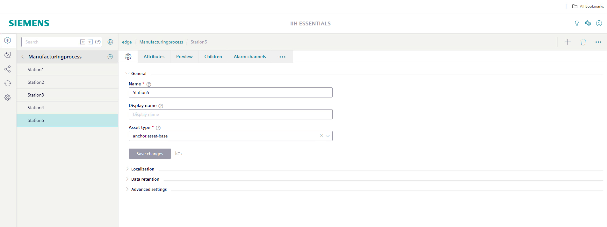</kbd>

### Configure Aspects

Now, it's time to create the steps (aspects) that will be displayed in the **Step Time Analysis** dashboard on Performance Insights app.

For that, there are two predefined aspect types available within IIH Essentials (only available in standalone version of IIH Essentials):

- sca.initial-step
- sca.step

**sca.initial-step**

This aspect type is typically used for the very first step, which is the starting point for each sequence. It can only be used once per asset. This type covers two variables:

- *ActiveState* (Boolean)
- *Product* (String)

> Important: Step durations below 100ms will not be recognized as initial step and dashboard will not be created!

**sca.step**

This aspect type is used for all other steps within the sequence.It covers one variable:

- *ActiveState* (Boolean)

All defined aspect variables need to be mapped to a dedicated parameter from the PLC:

- *ActiveState*: status of the step's activity (Boolean) > mandatory for calculating the step duration times

- *Product*: name of the product that is tracked (String) > will later be available in the dashboard drop down list for selecting the product

**Create the aspects**

For each station, Step 2 is designated as the initial step. To do this, go to *Station 1*, click the '+' icon > type > Aspects > Add Aspect:

- Name = "Step 2"
- Type = *Aspect*
- Aspect type = *sca.initial-step*

Open the *Advanced settings*:

- Link type = *Composition* (**mandatory!**)
- Click *Add* to save the aspect

<kbd>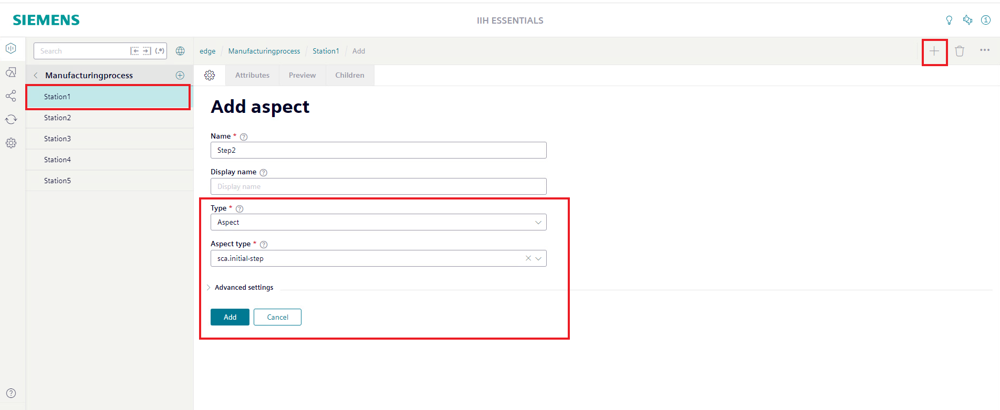</kbd>

For the remaining steps (3rd to 11th), assign the 'step' aspect type:

- Name = "Step 3"
- Type = *Aspect*
- Aspect type = *sca.step*

Open the *Advanced settings*:

- Link type = *Composition* (**mandatory!**)
- Click *Add* to save the aspect

<kbd>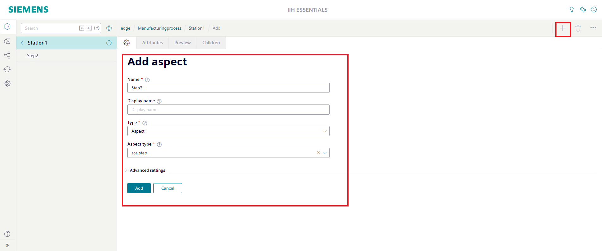</kbd>

Link the variables created during aspect addition with their respective asset tags. For the initial step (Step 2), two variables were created. Link the 'ActiveState' variable to its corresponding status tag *DB_HMI_PLC1.ARG1_Seq1_S2* on the asset connectivity tab:

<kbd>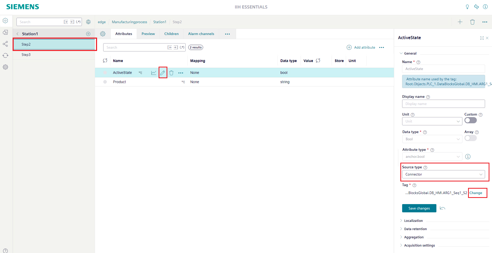</kbd>

Link the variable "Product" to the tag *DB_Process_Var_PLC1.Car_Type_inProduction_Text* on the asset connectivity tab, choose the sorce type as connector and click change to select the tag from OPC UA Connector on PLC_1:

<kbd>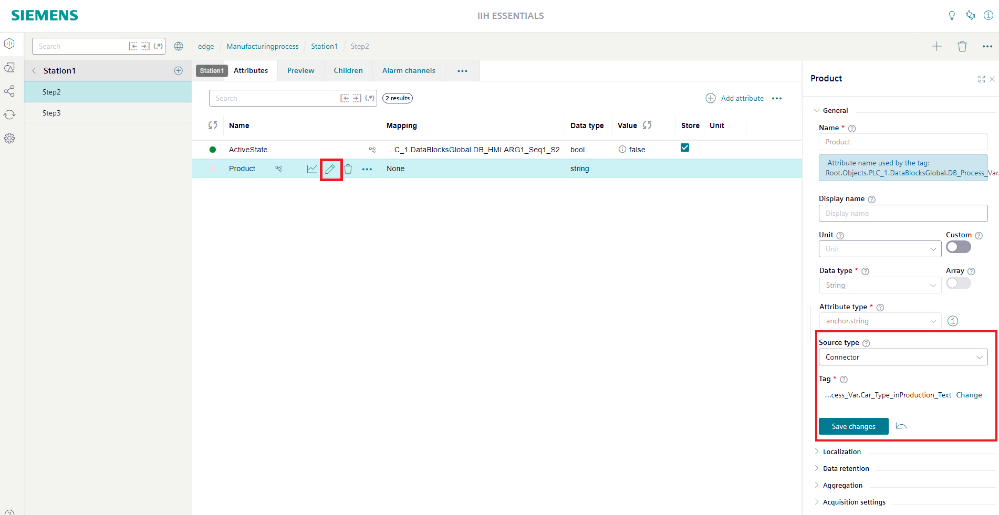</kbd>

For the remaining steps (3rd to 11th), similarly link the 'ActiveState' variable to its respective tag (e.g. DB_HMI_PLC1.ARG1_Seq1_S3 for Step3), just as you did for Step 2. After this, all steps be in "connected" state:

<kbd>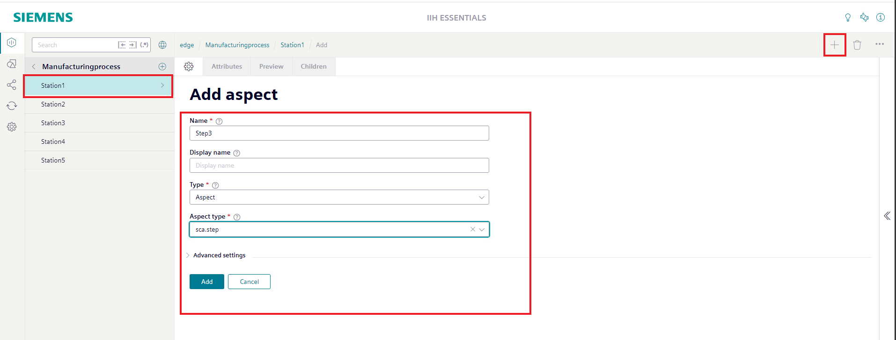</kbd>

Repeat this process for every station.

## Configure Performance Insight

After finishing the configuration of the IIH Essentials, open the Performance Insight application on the IED. With this appliation it is possible to get information about the duration of defined steps and observe limits of individual steps and sequences.

The asset structure that was created in IIH Essentials can also be found in Performance Insight. Perform an asset reload, in case the app was already open. Then click on the "My Plant" icon and select the dedicated asset where the aspects were created. An **auto-generated** "Step Time Analysis" dashboard is available:

<kbd>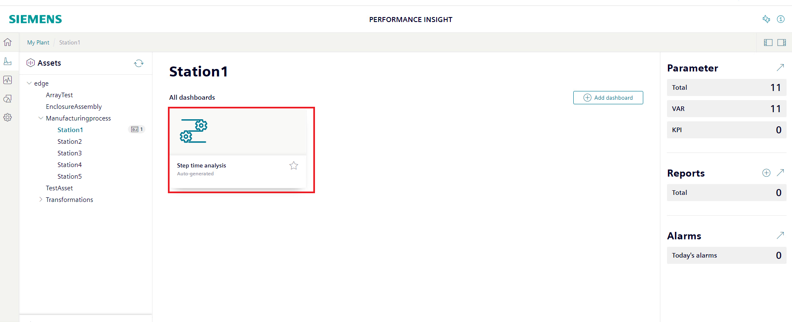</kbd>

Open the 'Step Time Analysis' dashboard to enter the overview page. If the TIA Portal project has been uploaded to the PLCs and the program initiated on the HMI, data should now display on the dashboard:

<kbd>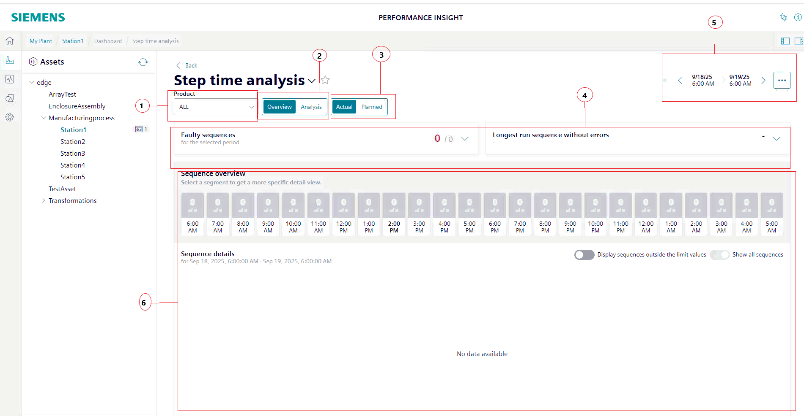</kbd>

Here's a more detailed overview of the functions for the buttons and elements on the Step Time Analysis dashboard:

1) Select a product for which the step time analysis is to be displayed
2) Switch the trend view
3) Select between "Actual" and "Planned" steps
4) Execution time of the faulty sequences
5) Displaying the steps with highest fault rate
6) Select a period for which the step time analysis is to be displayed
7) Switch to the limit definition in the Step Time Analysis configuration
8) Sequence overview: Display and selection of a specific sequence for detailed display
9) Sequence details: Displaying all sequences and defined steps in the selected period; when selecting a single step, the Trend view of the step opens

### Defining Limits

In this instance, a single sequence has occurred at Station1, as depicted in the graphic above. Now, limits need to be defined in the Step Time Analysis configuration tab:

<kbd>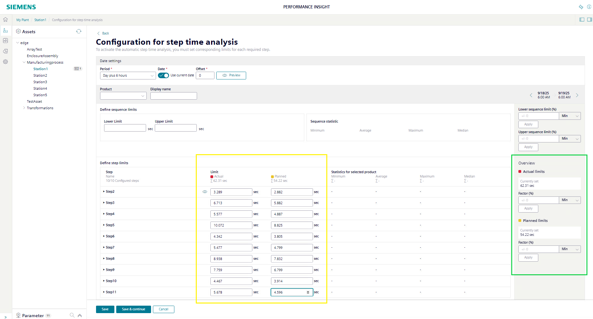</kbd>

In the "​Limits​" column (yellow square), set the values for the planned and actual duration of the respective step. When the value is exceeded, the step is evaluated as faulty.

​Under "​Overview​" (green square), you can automatically assign a limit to all steps using a mathematical function:

- ​Decide whether to assign the automatic limit to the actual, planned or all step limits
- From the drop-down menu, you select the minimum or the maximum as initial value of the step
- As the factor, you specify a percentage that is added to the initial value
- Click "​Apply to all steps​"

​A limit is calculated for selected steps on the basis of the respective limit values and entered in the corresponding column for limit values. To save the changes and switch to the dashboard view, click "​Save​". ​If you want to continue working in the same view after saving, click "​Save​ & ​Continue​". To exit the view without saving, click "​Cancel​".
